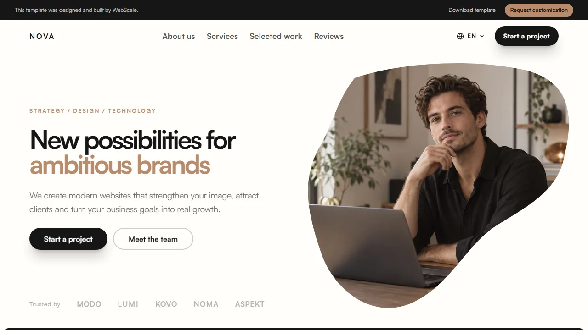
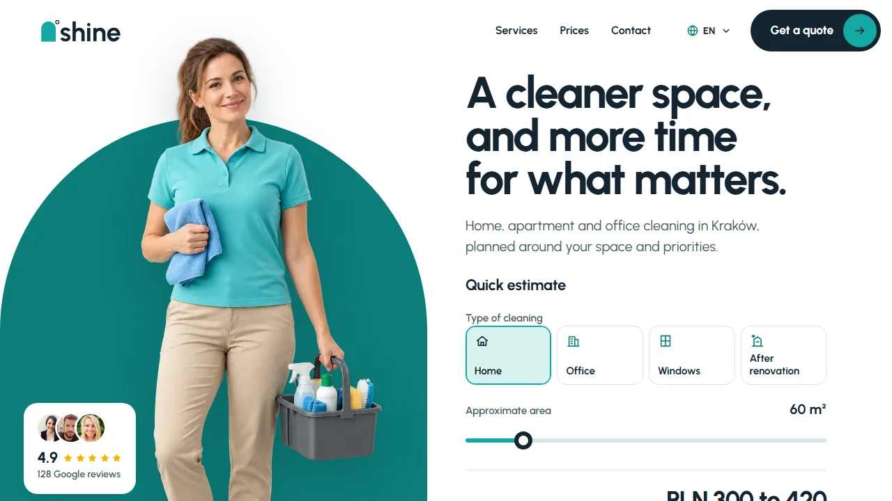
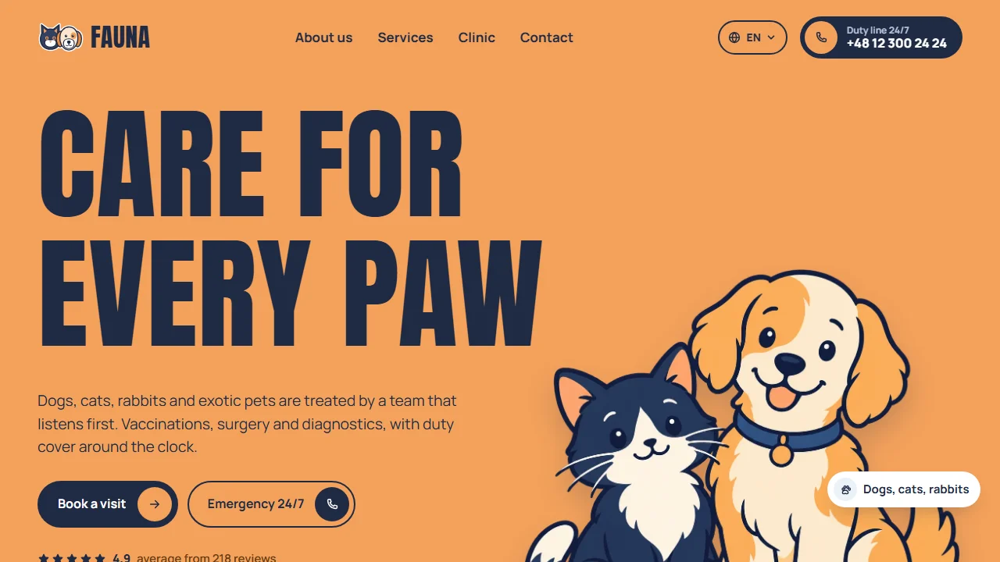
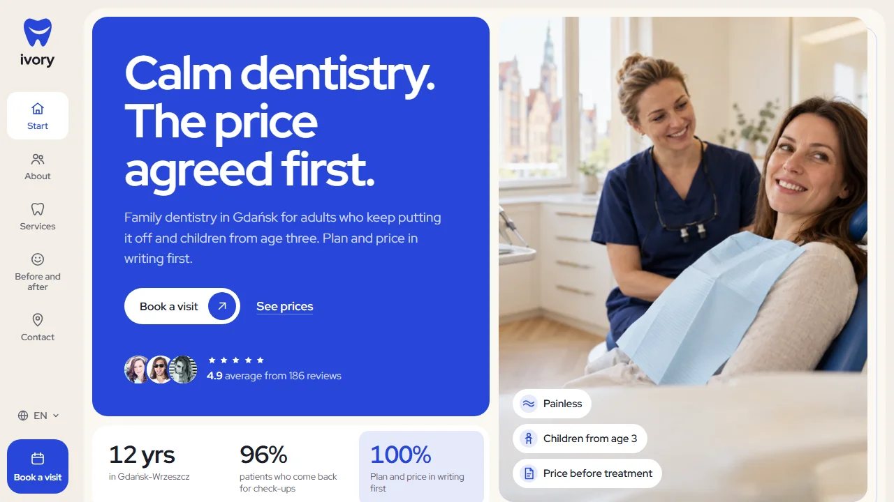
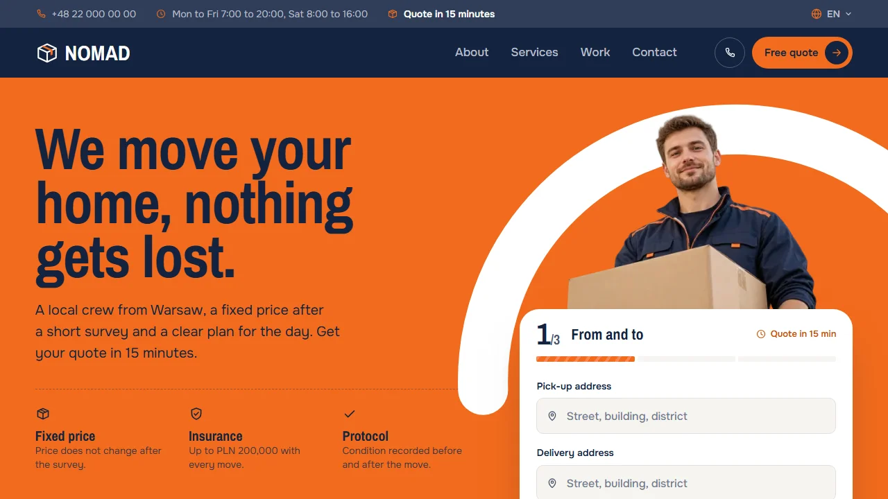

# WebScale Templates

A catalog of ready-made website templates built with Astro and Tailwind CSS. Every template has a live preview, a short description and links to where you can get it.

Free templates link to their public source repositories. Premium templates are sold on Gumroad under their own licence; their source code is not published here.

## Free templates

### Nova

[](https://webscale.pl/preview/nova/)

**Ready-made website for creative and marketing agencies.** Nova is a website template for creative and marketing agencies, with services, selected work, a team section and contact. Editorial typography, large imagery and ready-made sections give the site a distinctive visual direction. Replace the copy, photos and logo with your own before publishing.

[Live demo](https://webscale.pl/preview/nova/) · [Source code](https://github.com/Wiktorkulas51/template-t001-nova) · [Free on Gumroad](https://wiktorcraft172.gumroad.com/l/ai-ready-astro-template) · [Template page](https://webscale.pl/en/ready-made-websites/nova/)

Stack: Astro, Tailwind CSS

### Forma

[](https://webscale.pl/preview/forma/)

**Ready-made website for construction and renovation companies.** Forma is a website template for construction and renovation companies, with services, a project gallery, a work process and a contact form. Light surfaces, graphite typography and an amber accent give it a calm, architectural character. Replace the sample copy, photos and logo with your own before publishing.

[Live demo](https://webscale.pl/preview/forma/) · [Source code](https://github.com/Wiktorkulas51/forma-astro-template) · [Free on Gumroad](https://wiktorcraft172.gumroad.com/l/forma-astro-template) · [Template page](https://webscale.pl/en/ready-made-websites/forma/)

Stack: Astro, Tailwind CSS

## Premium templates

### Greenline

[](https://webscale.pl/preview/greenline/)

**Ready-made website for garden design and garden care businesses.** Greenline is a website template for garden design, planting and seasonal garden care businesses, with services, projects, a process section and a contact form. Calm greenery, light surfaces and a clear green accent give it a fresh, natural character. Replace the sample copy, photos and logo with your own before publishing.

[Live demo](https://webscale.pl/preview/greenline/) · [Buy on Gumroad, $79](https://wiktorcraft172.gumroad.com/l/greenline-astro-template) · [Template page](https://webscale.pl/en/ready-made-websites/greenline/)

Stack: Astro, Tailwind CSS

### Shine

[](https://webscale.pl/preview/shine/)

**Ready-made website for cleaning companies.** Shine is a website template for cleaning companies, with services, a before and after comparison, indicative prices and a quote form. Clear typography, a turquoise accent and deep navy give the website a fresh, local character. Replace the copy, photos, company details, prices and reviews with your own before publishing.

[Live demo](https://webscale.pl/preview/shine/) · [Buy on Gumroad, $79](https://wiktorcraft172.gumroad.com/l/shine-astro-template) · [Template page](https://webscale.pl/en/ready-made-websites/shine/)

Stack: Astro, Tailwind CSS

### Fauna

[](https://webscale.pl/preview/fauna/)

**Ready-made website for veterinary clinics.** Fauna is a website template for veterinary clinics, with a pet switch for services and prices, a 24/7 emergency line, a vet team and a styled map. Warm apricot, deep navy and a dog and cat mascot give the website a friendly, trustworthy character. Replace the copy, illustrations, clinic details, prices and reviews with your own before publishing.

[Live demo](https://webscale.pl/preview/fauna/) · [Buy on Gumroad, $79](https://wiktorcraft172.gumroad.com/l/fauna-astro-template) · [Template page](https://webscale.pl/en/ready-made-websites/fauna/)

Stack: Astro, Tailwind CSS

### Ivory

[](https://webscale.pl/preview/ivory/)

**Ready-made website for dental clinics.** Ivory is a website template for dental clinics, with a smile map that shows prices per area, tabbed price lists, a before and after slider and a team of dentists. Cobalt and sand, the Red Hat Display typeface and a bento layout give the website a calm, modern character. Replace the copy, photos, clinic details, prices and reviews with your own before publishing.

[Live demo](https://webscale.pl/preview/ivory/) · [Buy on Gumroad, $79](https://wiktorcraft172.gumroad.com/l/ivory-astro-template) · [Template page](https://webscale.pl/en/ready-made-websites/ivory/)

Stack: Astro, Tailwind CSS

### Nomad

[](https://webscale.pl/preview/nomad/)

**Ready-made website for moving companies.** Nomad is a website template for moving companies, with a three step quote on the first screen, priced packages, an hour by hour moving day plan, a fleet and insurance. An orange accent, deep navy and condensed typography give the website a practical, transport character. Replace the copy, photos, company details, prices and reviews with your own before publishing.

[Live demo](https://webscale.pl/preview/nomad/) · [Buy on Gumroad, $79](https://wiktorcraft172.gumroad.com/l/nomad-astro-template) · [Template page](https://webscale.pl/en/ready-made-websites/nomad/)

Stack: Astro, Tailwind CSS

## Bundle

**All templates, $199.** Buy once and get every template in the catalog, including the ones added later.

- Every current template with source code
- Every new template and update at no extra cost
- Help launching your first project
- White label licence: client launches under your brand

[Buy the bundle on Gumroad, $199](https://wiktorcraft172.gumroad.com/l/webscale-astro-templates-bundle)

## Custom website

Need a website based on one of these templates, with your content, photos and domain? Ask for a quote at [webscale.pl/en/quote](https://webscale.pl/en/quote/).

## License

- The catalog code (scripts, README generator and docs) is released under the [MIT License](LICENSE).
- Free templates are released under the MIT License.
- Premium templates have their own licence, shown on their Gumroad product page. The MIT License of this repository does not cover them.

## Development

```bash
npm install
npm run assets            # regenerate preview images from the live demos
npm run assets -- --only forma
npm run assets -- --only forma --files dribbble-screen   # re-render only file names containing the text
npm run readme            # regenerate this README from templates/*/template.json
```
