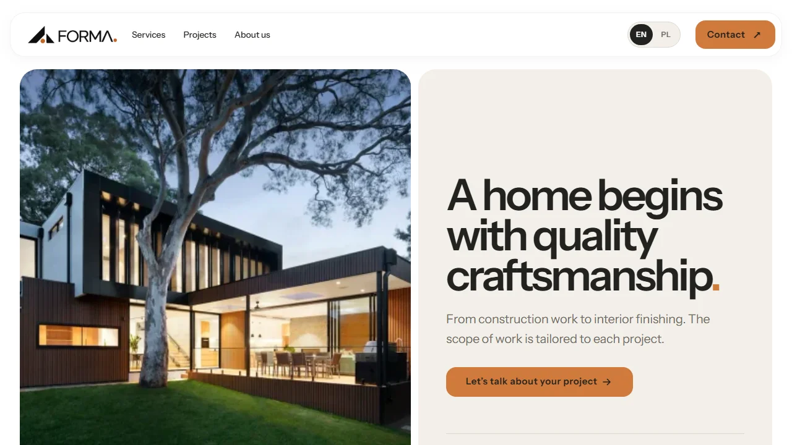
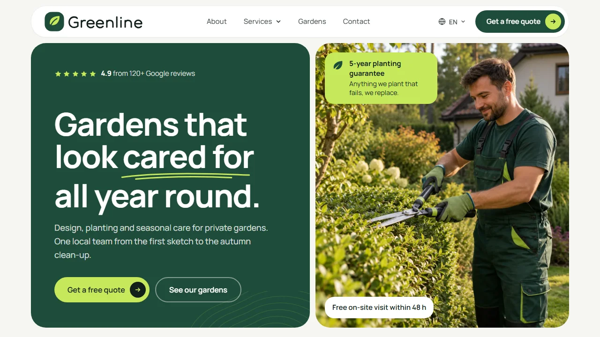

# WebScale Templates

A catalog of ready-made website templates built with Astro and Tailwind CSS. Every template has a live preview, a short description and links to where you can get it.

Free templates link to their public source repositories. Premium templates are sold on Gumroad under their own licence; their source code is not published here.

## Free templates

### Forma

[](https://webscale.pl/preview/forma/)

**Ready-made website for construction and renovation companies.** Forma is a website template for construction and renovation companies, with services, a project gallery, a work process and a contact form. Light surfaces, graphite typography and an amber accent give it a calm, architectural character. Replace the sample copy, photos and logo with your own before publishing.

[Live demo](https://webscale.pl/preview/forma/) · [Source code](https://github.com/Wiktorkulas51/forma-astro-template) · [Free on Gumroad](https://wiktorcraft172.gumroad.com/l/forma-astro-template) · [Template page](https://webscale.pl/en/ready-made-websites/forma/)

Stack: Astro, Tailwind CSS

## Premium templates

### Greenline

[](https://webscale.pl/preview/greenline/)

**Ready-made website for garden design and garden care businesses.** Greenline is a website template for garden design, planting and seasonal garden care businesses, with services, projects, a process section and a contact form. Calm greenery, light surfaces and a clear green accent give it a fresh, natural character. Replace the sample copy, photos and logo with your own before publishing.

[Live demo](https://webscale.pl/preview/greenline/) · [Buy on Gumroad, $79](https://wiktorcraft172.gumroad.com/l/greenline-astro-template) · [Template page](https://webscale.pl/en/ready-made-websites/greenline/)

Stack: Astro, Tailwind CSS

## Bundle

**All templates, $199.** Buy once and get every template in the catalog, including the ones added later.

- Every current template with source code
- Every new template and update at no extra cost
- Help launching your first project
- White label licence: client launches under your brand

[Buy the bundle on Gumroad, $199](https://wiktorcraft172.gumroad.com/l/webscale-astro-templates-bundle)

## Custom website

Need a website based on one of these templates, with your content, photos and domain? Ask for a quote at [webscale.pl/en/quote](https://webscale.pl/en/quote/).

## License

- The catalog code (scripts, README generator and docs) is released under the [MIT License](LICENSE).
- Free templates are released under the MIT License.
- Premium templates have their own licence, shown on their Gumroad product page. The MIT License of this repository does not cover them.

## Development

```bash
npm install
npm run assets            # regenerate preview images from the live demos
npm run assets -- --only forma
npm run readme            # regenerate this README from templates/*/template.json
```
